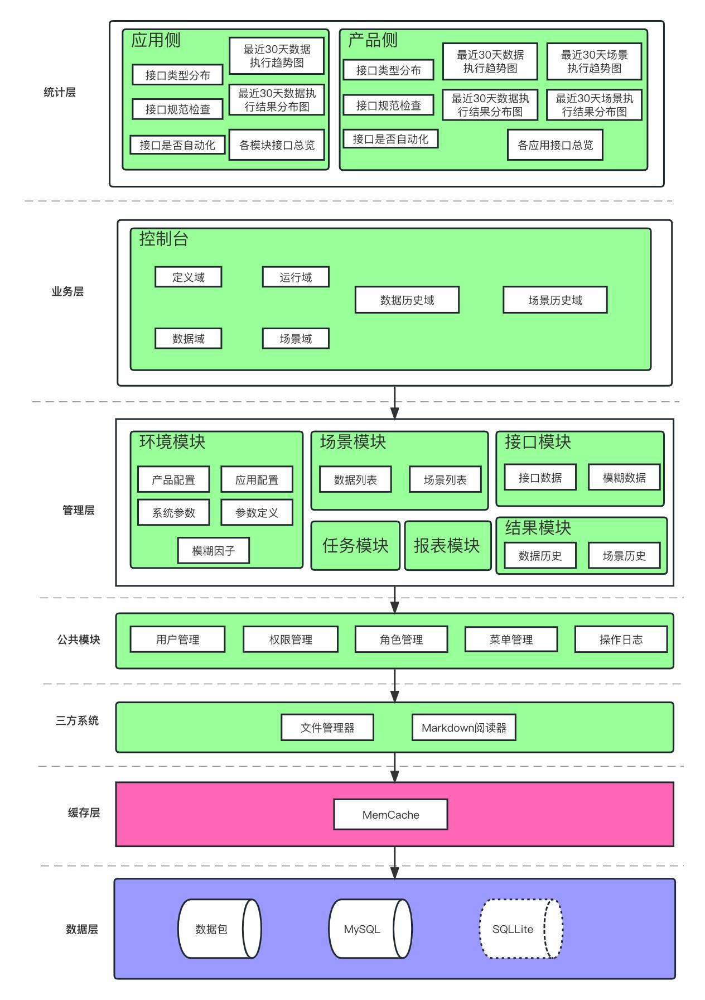
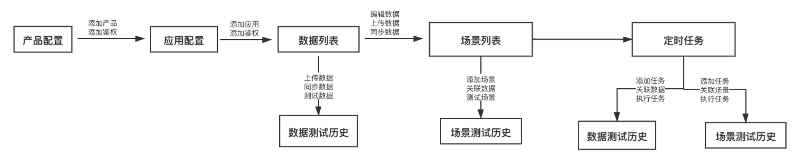
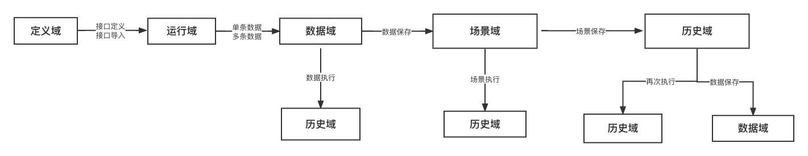
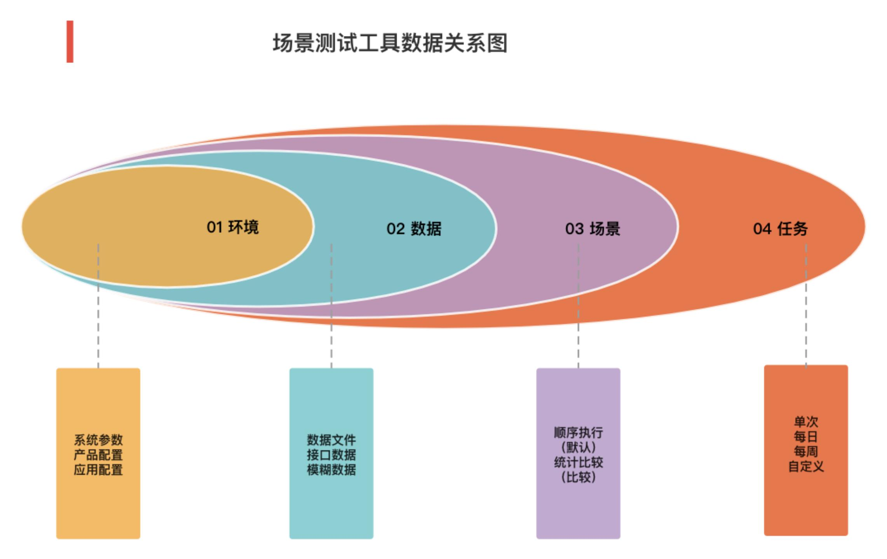

#### Dependency Frameworks
- Database ORM Framework: GORM v1.9.16
- Web Framework: Gin v1.7.2
- File Management Framework: Filemanager v0.0.7
- Backend Data Management Framework: GoAdmin v1.2.24
- UI Component Library: Iview v2.7.4
- Console Development Framework: Vue 2.5.2
- Console Frontend: Secondary development based on the frontend framework of goman
- Go Toolchain: 1.27.3 (go.mod `go` directive 1.23)

#### Run Modes
- Web mode: full web service (GoAdmin + Gin), management data stored in MySQL, execution history stored in server files.
- CLI mode: CLI/SQLite standalone run mode, uses SQLite storage, CLI execution of data/scenarios.

#### Architecture Diagram

#### Global Usage Flow

#### Data Flow Diagram

#### System Data Relationship Diagram

